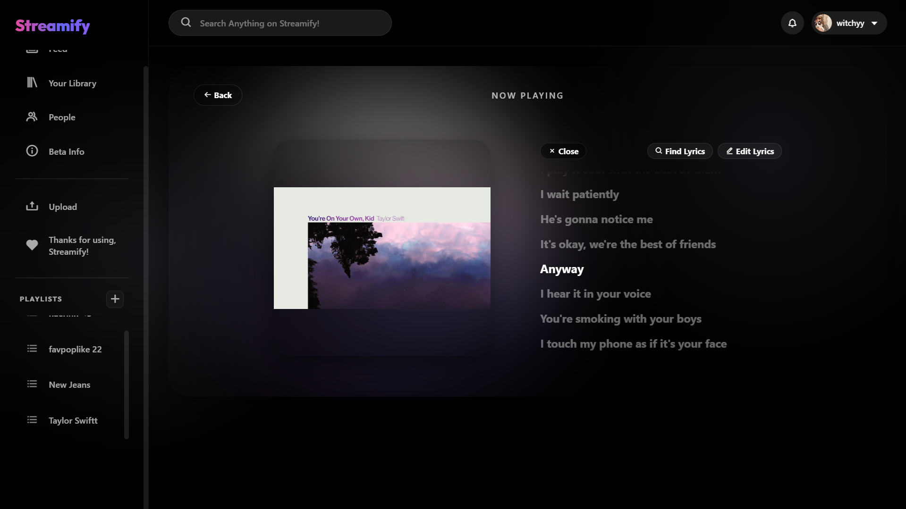
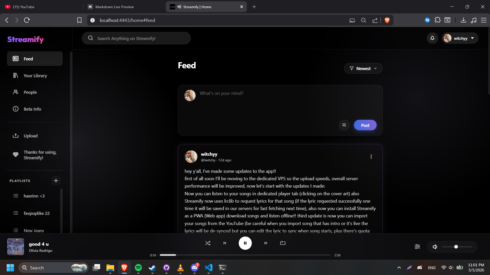
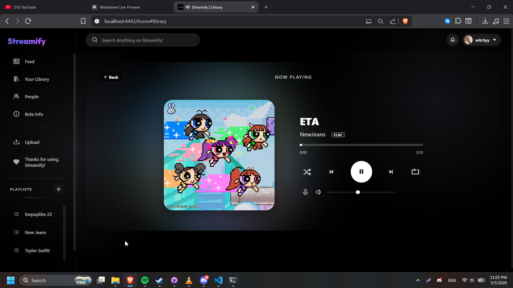
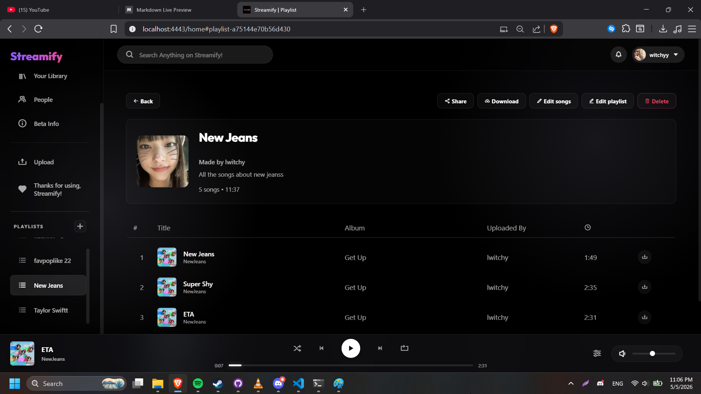

# Streamify



Streamify is your own self-hosted music streaming app built with Node.js. Think of it like your personal streaming platform, but you actually own your files and data. No subscriptions, just pure music.

## Features

*   **User Authentication**: Secure logins and sessions so nobody hijacks your account.
*   **Music Library**: Read your tracks from a configured local directory, organize them, and build your collection.
*   **Playlists**: Curate your own custom playlists and share them with friends.
*   **FLAC Streaming**: High quality lossless audio support for the audiophiles out there.
*   **Lyrics Support**: Fetch and sync lyrics seamlessly using the LRCLIB API.
*   **Smart Auto Enrich**: Owner-reviewed local, text-registry, or optional AcoustID fingerprint matching for missing metadata and covers.
*   **User Profiles & Privacy**: Custom avatars, banners, account-scoped playlists, history, and offline storage.
*   **Basic Telemetry**: We track your listening habits locally to generate stats on your favorite tracks. This data is private and can be exported anytime.
*   **Responsive UI**: Supports desktop and mobile layouts and can be installed as a PWA in a secure context.

## Tech Stack

*   **Backend**: Node.js, Express, Socket.io
*   **Database**: SQLite
*   **Media Processing**: FFmpeg, node-id3, fluent-ffmpeg
*   **Frontend**: Vanilla JS, CSS, HTML

## Requirements

*   Node.js (v22.12+)
*   FFmpeg is bundled automatically; no system install is required
*   SSL certificates only if you are putting this on the public internet

Optional acoustic identification uses the free non-commercial AcoustID service.
The Owner supplies an AcoustID application client key during OOBE or later in
Settings. Streamify sends only a Chromaprint fingerprint and duration, never the
audio file.

## Installation

1. Clone the repo
```bash
git clone https://github.com/yourusername/Streamify.git
cd Streamify
```

2. Install dependencies (from the repo root)
```bash
npm install
```

3. Choose how you want to run it

**As a Windows desktop app:**
```bash
npm run desktop
```

**As a web server (for phones and other devices):**
```bash
npm start
```

Streamify prints every address it is reachable on:

```
  Streamify is running
  |- On this device : http://localhost:4443
  \- On your network: http://192.168.1.178:4443  (Wi-Fi)
```

Change the port with the `PORT` environment variable.

On a fresh installation, create the first Owner account from `localhost` or the
desktop window before opening Streamify to other LAN devices.

## Building the Windows installer

```bash
npm run build
```

Produces `dist-electron/Streamify-Setup-<version>.exe` — a per-user installer
that needs no administrator rights. The desktop app runs the same server
internally, so phones on your network can connect to it at the same time.
There is only ever one server, one database and one music library.

## Using it from your phone

Streamify is an installable PWA. Open the network address shown at startup, or
use **Tray → Connect your phone…** in the desktop app for a QR code.

One caveat worth knowing: browsers restrict offline downloads and
"Add to Home Screen" to *secure contexts*. Over plain HTTP on your LAN, music
streaming, search, playlists and lock-screen controls all work fine — but those
two features are unavailable. To unlock them:

```bash
npm run gen-cert
```

then restart. See **[DEPLOYMENT.md](DEPLOYMENT.md)** for the full breakdown,
including Cloudflare Tunnel and Tailscale setups.

## Local Music Directory

Streamify indexes audio files from the directories configured in
`Server/config.json`. That file is created automatically from
`Server/config.example.json` on first run, and is **not** tracked by git because
it contains machine-specific absolute paths.

```json
{
	"music_directory": "../MusicLibrary/uploads",
	"music_directories": [
		"C:/Users/you/Music",
		"D:/Media/FLAC"
	]
}
```

Entries may be absolute, or relative to the data directory. In the desktop app
you can pick folders with a native **Browse** button instead of typing paths.
Supported formats are MP3, WAV, M4A, FLAC, OGG, and WebM. Place files in that directory and open Your Library; Streamify reads their embedded metadata and indexes them without copying, compressing, or uploading them. Removing a managed file removes its folder-managed library record on the next refresh.

## Documentation

*   **Deployment:** [DEPLOYMENT.md](DEPLOYMENT.md)
*   **Documentation index:** [MD Files/INDEX.md](MD%20Files/INDEX.md)
*   **Current engineering audit:** [PROJECT_AUDIT.md](MD%20Files/Engineering/PROJECT_AUDIT.md)
*   **Smart Auto Enrich update:** [SMART_AUTO_ENRICH_UPDATE.md](MD%20Files/Engineering/SMART_AUTO_ENRICH_UPDATE.md)

## Project Structure

```
Streamify/
├── electron/               # Desktop app shell
│   ├── main.js             # Hosts the server, window, tray
│   ├── preload.js          # Sandboxed bridge to the web UI
│   └── connect.html        # "Connect your phone" QR window
├── Server/                 # The Node.js backend
│   ├── server.js           # Main entry point (exports start())
│   ├── runtime.js          # Paths, port, TLS detection, LAN discovery
│   ├── auth.js             # Handles the login flow
│   ├── database.js         # SQLite wrappers
│   ├── media.js            # Audio processing
│   ├── aiMetadata.js       # Enrichment orchestration
│   ├── metadataMatching.js # Text/evidence scoring
│   ├── metadataProviders.js# MusicBrainz, Apple, AcoustID adapters
│   └── fingerprint.js      # Safe fpcalc runtime
├── Static/                 # Frontend files (HTML/CSS/JS)
│   └── vendor/             # Locally hosted fonts, icons, cropper.js
├── MD Files/               # Internal engineering and historical documentation
├── Scripts/
│   └── generate-cert.js    # Self-signed LAN certificates
├── MusicLibrary/           # Where your uploaded tracks live
├── vendor/fpcalc/          # Pinned cross-platform Chromaprint binaries
├── Tests/                  # Metadata matching/provider tests
├── Database/               # SQLite files and backups
└── package.json            # Single dependency manifest (repo root)
```

Everything under `Static/` is served locally — Streamify makes **no** requests
to CDNs, so it works on a fully offline network.

## Security

We built some decent security in here. It has rate limiting to stop brute force attacks, secure cookies, and password hashing. But seriously, do not run this in a massive production environment without putting it behind a proper reverse proxy like Nginx or Cloudflare.

## Troubleshooting

*   **Port in use**: Set the `PORT` environment variable, e.g. `set PORT=8080`.
*   **Missing directories**: The app creates them on startup. If that fails, check permissions on the data directory.
*   **Desktop app won't start**: Read `%APPDATA%\Streamify\logs\main.log`.
*   **Phone can't connect**: Check Windows Firewall, and that both devices are on the same network. Guest/AP-isolated Wi-Fi blocks device-to-device traffic.
*   **No offline downloads on phone**: You're on plain HTTP. Run `npm run gen-cert`, or see [DEPLOYMENT.md](DEPLOYMENT.md).
*   **Native module errors** after changing Node/Electron versions: `npm run rebuild`.

## Contact

Found a bug or want to contribute? Open a GitHub issue.
Telegram: @lwitchy
Discord: @lwitchy

## Acknowledgments

Huge thanks to [EnderMythex](https://github.com/EnderMythex) for helping test the security, finding exploits so they could be fixed!

Thanks to everyone contributing. Have fun streaming.

## Screenshots




